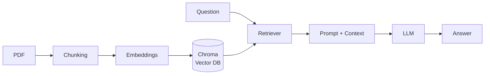
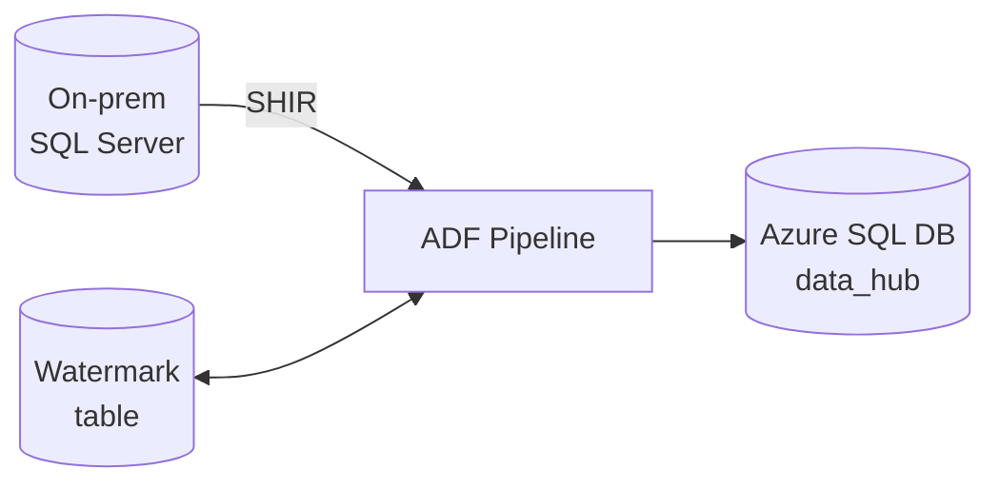

<h1 align="left"> Hi, I'm Sumit Vishwakarma</h1>

  <b>Aspiring AI Data Engineer</b> · Python · SQL · PySpark 
  Azure · Databricks · Microsoft Fabric · RAG · LangChain · LangGraph

  
  
  

---

## 🧭 About Me

I'm a BCA student at **MERI, New Delhi** (graduating 2027) building towards a career as an **AI Data Engineer**: the person who builds the data foundations that make AI applications reliable. I like turning raw, messy data into clean, analytics-ready tables, and now into the pipelines that feed **LLM and RAG systems**.

- 🔭 Currently building: lakehouse and warehouse projects on **Azure** and **Microsoft Fabric**
- 🤖 Built a **RAG assistant** with LangChain, OpenAI and Chroma, and now learning **LangGraph** agent workflows
- 🌱 Currently deepening: **Delta Lake**, **Airflow** orchestration, dimensional modeling
- 🏆 Won **1st place** in a college SQL query optimization contest
- 📫 Reach me at **svisemployed@gmail.com**

---

## 🛠️ Tech Stack

### 🧑‍💻 Languages & Analytics

  
  
  
  
  
  

### ☁️ Data Engineering & Cloud

  
  
  
  
  
  
  

### 🤖 AI & LLMs

  
  
  
  

### 📊 BI & Visualization

  
  
  

### 🏗️ Concepts
`ETL / ELT` · `Star Schema` · `Fact & Dimension Modeling` · `Data Warehousing` · `Medallion Architecture` · `Parquet` · `Query Optimization` · `Retrieval-Augmented Generation (RAG)` · `LLM Agent Workflows`

---

## 🚀 Featured Projects

### 🤖 DataForge RAG: AI Assistant over *Fundamentals of Data Engineering*
`Python` · `LangChain` · `OpenAI LLM & Embeddings` · `Chroma` · *Phase 1 completed Aug 2026*

- Built a **RAG pipeline** that answers questions from a large data engineering book (PDF) using only retrieved context
- Loaded the PDF with `PyPDFLoader`, split it with `RecursiveCharacterTextSplitter` (with chunk overlap) and embedded the chunks with **OpenAI Embeddings**
- Stored vectors in **Chroma**, retrieved the most relevant chunks via semantic similarity search, injected them into a prompt template and generated grounded answers with an **OpenAI LLM**

📂 [Repository](https://github.com/svwxyz)

---

### 🔄 On-Prem to Cloud Incremental Data Pipeline
`Azure Data Factory` · `Self-Hosted Integration Runtime` · `SQL Server` · `Azure SQL Database` · `T-SQL` · *Feb 2026*

- Built a hybrid **on-prem SQL Server to Azure SQL Database** migration using a **Self-Hosted Integration Runtime**
- Designed a **watermark-based incremental load**: Lookup the last watermark, Copy only new or updated rows, Lookup the max loaded date, then update the watermark with a **stored procedure**
- Made it **restartable and re-runnable**: the watermark moves only after a successful copy, uses `DATETIME2` precision to avoid data loss, and runs on a **daily schedule trigger**
- Parameterized and reusable across tables (`customer`, `orders`)

📂 [Repository](https://github.com/svwxyz/OnPrem2CloudDataPipeline)

---

### 🏗️ 30x Data Engineering: Production-Style Pipeline Series
`Azure` · `Databricks` · `Delta Lake` · `Synapse` · `Microsoft Fabric` · *ongoing*

A hands-on series of end-to-end projects, including:

- **Databricks E-commerce Lakehouse**: pipeline built on **medallion architecture** (Bronze, Silver, Gold), documented in its own README
- **Ecommerce Lakeflow Pipeline** and **Retail Delta Lake** projects on Databricks
- **Metadata-driven pipeline** and **back-dated data migration** in Azure Data Factory
- **SQL to Data Lake** production pipeline and a **Sales Data Warehouse**

📂 [Repository](https://github.com/svwxyz/30x-data-engineering)

---

### 📦 More Projects

| Project | Stack | Date |
|---|---|---|
| **Fabric Retail Sales Data Warehouse**: star schema (fact and dimension tables) for sales and revenue analytics | Microsoft Fabric | Mar 2026 |
| **IMDB Data Engineering Pipeline**: ADF ingestion, PySpark transformations in Databricks, Parquet output to Azure Data Lake | ADF, Databricks, ADLS | Sep 2025 |
| **Instagram User Analytics**: SQL analysis of user behavior with Tableau dashboards | SQL, Tableau | Jan 2025 |

---

## 📈 GitHub Stats

  
  

  

### 🏆 Trophies

  

### 📊 Contribution Activity

  

  

---

  <i>Always learning, always building pipelines. Let's connect! 🤝</i>

